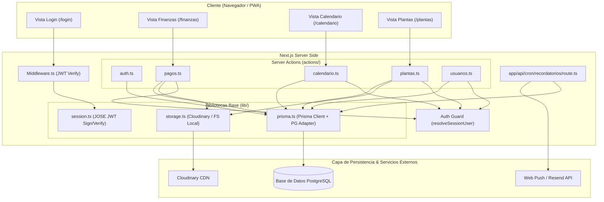
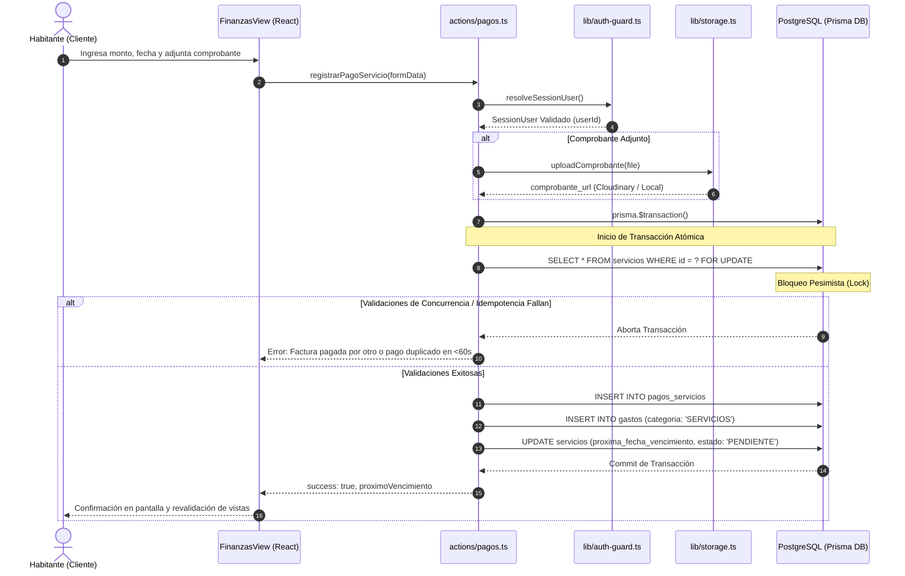

# Manual Técnico de Arquitectura y Sistema: HogarApp (BigHouseApp)

Este documento constituye el manual técnico oficial de **HogarApp** (BigHouseApp). Su objetivo es proporcionar una guía exhaustiva y detallada sobre la arquitectura, el stack tecnológico, los modelos de persistencia, los flujos de trabajo críticos y las reglas de negocio codificadas, facilitando un proceso de onboarding ágil y una comprensión profunda para desarrolladores de software y arquitectos.

---

## 1. Visión General del Sistema

### Propósito Funcional de la Aplicación
**HogarApp** (BigHouseApp) es una plataforma web progresiva (PWA / Web App) diseñada para la gestión colaborativa e integral del hogar entre habitantes y convivientes. Centraliza y automatiza cuatro áreas operativas clave:

1. **Finanzas y Servicios Recurrentes**: Control de facturas de servicios públicos/privados, cálculo automático de fechas de vencimiento, procesamiento de pagos con soporte para comprobantes (imágenes/PDF) y vinculación automática con el registro global de gastos del hogar.
2. **Calendario Colaborativo y Agenda del Hogar**: Planificación de actividades mediante un sistema de plantillas especializadas (Citas Médicas, Tareas del Hogar, Cumpleaños, Mercado, Citas, etc.), asignación de responsables, listas de subtareas y recordatorios multicanal.
3. **Gestión Botánica y Cuidados**: Registro de plantas del hogar, programación de frecuencias de riego y trazabilidad histórica de mantenimiento por habitante.
4. **Administración de Habitantes y Autenticación Segura**: Gestión de perfiles del hogar con sesiones basadas en JWT y acceso rápido mediante PIN numérico o contraseña tradicional.

### Stack Tecnológico

| Categoría | Herramienta / Lenguaje | Versión Inferida | Justificación / Uso en el Sistema |
| :--- | :--- | :--- | :--- |
| **Framework Full-Stack** | Next.js (App Router) | `16.3.5` | Framework principal. Utiliza Server Actions para la lógica de negocio y Route Handlers para endpoints de sistema (cron jobs). |
| **Runtime & Biblioteca UI** | Node.js / React | Node `v20+` / React `19.2.8` | Entorno de ejecución en servidor/cliente y renderizado de componentes iterativos con React 19. |
| **Lenguaje de Programación**| TypeScript | `^5.0.0` | Tipado estático en todo el proyecto para garantizar la integridad de datos entre cliente, servidor y ORM. |
| **Base de Datos Relacional**| PostgreSQL | `[DATO NO DISPONIBLE EN EL MATERIAL PROVISTO: Pendiente de validación con el equipo]` | Motor de base de datos relacional para la persistencia transaccional y control de concurrencia. |
| **ORM & Driver DB** | Prisma ORM con `@prisma/adapter-pg` y `pg` | Prisma `^7.9.1` / `@prisma/adapter-pg` `^7.10.0` / `pg` `^8.23.0` | Mapeo objeto-relacional, migraciones y pool de conexiones PostgreSQL con soporte de adaptadores modernos. |
| **Autenticación & Criptografía** | `jose` y `bcryptjs` | `jose` `^6.2.10` / `bcryptjs` `^3.0.3` | Firma e inspección de JWT en cookies HttpOnly (`jose`), y hashing de contraseñas y PINs numéricos (`bcryptjs`). |
| **Almacenamiento de Archivos**| Cloudinary / Local FS | `cloudinary` `^2.11.0` | Almacenamiento de fotos de plantas y comprobantes en producción/Serverless (Cloudinary) con fallback a sistema de archivos local (`public/uploads`) en desarrollo. |
| **Estilos & Componentes UI**| Tailwind CSS & Lucide React | Tailwind `^4.0.0` / Lucide `^1.38.0` | Motor de diseño utilitario de alta velocidad y paquete de iconografía vectorial. |
| **Notificaciones & Cron** | Web-Push & Resend | `web-push` `^3.6.7` / `resend` `^6.28.1` | Infraestructura para envío de notificaciones Push PWA y correos electrónicos transaccionales. |
| **Testing & Calidad** | Jest & Testing Library | Jest `^30.5.1` / React TL `^16.3.3` | Framework de pruebas unitarias e integración para validar Server Actions y lógica financiera. |

---

## 2. Arquitectura y Componentes

### Descripción de la Arquitectura de Alto Nivel
El sistema utiliza una **Arquitectura Monolítica Modular basada en Next.js App Router** impulsada por **Server Actions** y un patrón de **Data Access Layer (DAL)** memoizado.

1. **Capa de Presentación (Frontend/SSR)**: Páginas renderizadas en el servidor (`app/`) e interfaz interactiva modular (`components/`) dividida por dominios funcionalmente aislados (`auth`, `calendario`, `pagos`, `plantas`, `usuarios`).
2. **Capa de Control de Acceso (Middleware & Guards)**:
   - `middleware.ts`: Intercepta peticiones HTTP para rutas protegidas y verifica la validez del token JWT en la cookie `hogar_session`.
   - `lib/auth-guard.ts`: Proporciona la función `resolveSessionUser()`, memoizada por request mediante `cache()` de React. Garantiza que la identidad del ejecutor provenga **exclusivamente** de la cookie firmada y valida que el usuario permanezca activo en la BD.
3. **Capa de Servicios y Lógica de Negocio (`actions/`)**: Las interacciones del usuario invocan funciones asíncronas de servidor (Server Actions) como `loginConCredenciales`, `registrarPagoServicio`, `crearEvento`, `registrarCuidado`, etc.
4. **Capa de Persistencia e Integración (`lib/`)**:
   - `lib/prisma.ts`: Inicializa una instancia global de `PrismaClient` conectada a PostgreSQL mediante un pool de conexiones `pg`.
   - `lib/storage.ts`: Abstrae la subida de archivos seleccionando dinámicamente Cloudinary en producción o el disco local en desarrollo.

### Diagrama de Flujo de Arquitectura y Componentes



### Estructura de Directorios Explicada

```text
hogar-app/
├── actions/                  # Server Actions (Lógica de negocio accesible desde el cliente)
│   ├── auth.ts               # Login tradicional, por PIN/Perfil, registro y logout
│   ├── calendario.ts         # Consultas y mutaciones de eventos (reglas por plantilla)
│   ├── eventos.ts            # Operaciones complementarias de eventos y sub-recursos
│   ├── pagos.ts              # Gestión de servicios, liquidación atómica de pagos e historial
│   ├── plantas.ts            # Registro de plantas, tareas de riego e historial de cuidado
│   └── usuarios.ts           # CRUD y administración de cuentas de usuario/habitantes
├── app/                      # Rutas y páginas de Next.js App Router
│   ├── api/cron/             # Enrutador para tareas programadas de fondo
│   │   └── recordatorios/    # Route handler GET para despacho de notificaciones push/email
│   ├── calendario/           # Interfaz de agenda visual y mensual
│   ├── finanzas/             # Dashboard financiero, métricas y gestión de egresos
│   ├── login/                # Pantalla de inicio de sesión (Selector de perfil + PIN)
│   ├── plantas/              # Catálogo botánico y control de riego
│   ├── register/             # Formulario de alta para nuevos habitantes
│   ├── servicios/            # Control analítico de servicios recurrentes
│   ├── usuarios/             # Panel de gestión de miembros del hogar
│   ├── layout.tsx            # Envoltorio principal de la aplicación (Providers y TabBar)
│   └── page.tsx              # Dashboard / Lobby principal con resúmenes ejecutivos
├── components/               # Componentes de React reutilizables por dominio
│   ├── auth/                 # Forms de autenticación y temporizador de inactividad
│   ├── calendario/           # Vistas de agenda, modales contextuales y plantillas de evento
│   ├── layout/               # Navegación superior, barra de pestañas inferior y temas
│   ├── pagos/                # Tarjetas de servicio, modales de pago y soporte de adjuntos
│   ├── plantas/              # Tarjetas de planta, temporizadores de riego y modales de cuidado
│   └── ui/                   # Componentes atómicos de interfaz (botones, inputs, modales)
├── lib/                      # Núcleo de utilidades y configuraciones del servidor
│   ├── auth-guard.ts         # Guard de sesión memoizado (resolveSessionUser)
│   ├── auth-secret.ts        # Obtención segura de clave secreta para firmas JWT
│   ├── image-compression.ts  # Compresión de imágenes en cliente previo a subida
│   ├── prisma.ts             # Cliente Prisma singleton con adaptador PG
│   ├── session.ts            # Manejo de cookies HttpOnly y encriptación JWT con JOSE
│   └── storage.ts            # Adaptador de almacenamiento (Cloudinary vs Sistema de Archivos Local)
├── prisma/                   # Definiciones de base de datos
│   ├── schema.prisma         # Esquema relacional completo (Modelos, relaciones e índices)
│   └── prisma.config.ts      # Configuración de herramientas de Prisma
├── public/                   # Archivos estáticos y directorio de subida local fallback (/uploads)
├── middleware.ts             # Interceptor de peticiones HTTP para protección de rutas
├── package.json              # Manifiesto de dependencias del proyecto
└── tsconfig.json             # Configuración de compilación de TypeScript
```

---

## 3. Flujos de Trabajo y Casos de Uso Críticos

### Caso de Uso 1: Autenticación y Cambio de Usuario (Perfil + PIN / Contraseña)
- **Flujo**: Selección de Perfil -> Verificación Criptográfica -> Firma JWT Cookie -> Redirección.
- **Entrada**: Selección de habitante en el selector visual de login + ingreso de PIN (4-6 dígitos) o contraseña.
- **Procesamiento**:
  1. `loginConCredenciales(usuarioId, credential, usarPin)` en `actions/auth.ts` recupera el usuario en PostgreSQL por ID.
  2. Valida la credencial ingresada usando `bcrypt.compare` contra `pin_hash` o `password_hash`. Si la contraseña almacenada requiere actualización de formato, realiza re-hashing transparente.
  3. Al validar exitosamente, invoca `createSession(...)` de `lib/session.ts` para firmar un JWT (algoritmo `HS256`, 30 días de expiración) y lo inyecta en la cookie HttpOnly `hogar_session`.
- **Salida**: Objeto `{ success: true, data: { id, nombre, email } }` y revalidación de caché de Next.js (`revalidatePath`).

### Caso de Uso 2: Registro de Pago de Servicio (Transacción Atómica Anti-Doble Pago)
- **Flujo**: Confirmación de Formulario -> Subida de Comprobante -> Transacción DB con Lock -> Recálculo Vencimiento.
- **Entrada**: Formulario con ID de servicio, monto pagado, fecha de pago, comprobante opcional (File) y la fecha de vencimiento que visualizaba el cliente (`fecha_vencimiento_esperada`).
- **Procesamiento**:
  1. Identificación del autor mediante `resolveSessionUser()`.
  2. Almacenamiento del archivo de comprobante mediante `uploadComprobante()` (retorna URL pública).
  3. Ejecución de `prisma.$transaction`:
     - **Bloqueo Pesimista (Locking)**: Ejecuta `SELECT ... FOR UPDATE` sobre la fila del servicio en PostgreSQL para impedir modificaciones concurrentes.
     - **Control de Concurrencia Optimista por Ciclo**: Valida que la fecha de vencimiento esperada coincida con la de la BD para evitar dobles registros si otro usuario pagó en paralelo.
     - **Idempotencia Anti-Doble Clic**: Verifica si existe un pago registrado para el mismo servicio y monto dentro de la ventana de 60 segundos previa.
     - Inserta el registro en `pagos_servicios`.
     - Inserta un nuevo egreso en `gastos` bajo la categoría `'SERVICIOS'`.
     - Calcula la nueva fecha de vencimiento (`calcularProximaFechaVencimiento`), aplicando periodicidad en meses y respetando el día de corte deseado (`dia_vencimiento`).
     - Actualiza el estado del servicio a `'PENDIENTE'` con su nueva fecha de vencimiento.
- **Salida**: Retorna `{ success: true, data: { pagoId, proximoVencimiento } }`.

### Caso de Uso 3: Creación y Edición de Eventos con Recurrencia (RF-03)
- **Flujo**: Formulario de Evento -> Validación de Plantilla -> Mutación DB -> Desvinculación de Serie Recurrente.
- **Entrada**: Datos del evento (título, fechas, tipo de plantilla, regla de recurrencia) y opción de edición (`SOLO_ESTE`, `ESTE_Y_FUTUROS`).
- **Procesamiento**:
  1. `crearEvento` / `actualizarEvento` evalúa validaciones específicas según plantilla:
     - `CITA_MEDICA`: Exige hora específica (`todo_el_dia = false`), ubicación obligatoria y paciente asignado.
     - `TAREA`: Requiere al menos un responsable asignado.
  2. Si se edita un evento recurrente seleccionando `SOLO_ESTE`:
     - Crea una nueva instancia de evento independiente (`recurrencia = null`) asignada a la fecha actual.
     - Para la serie original, adelanta la `fecha_inicio` y `fecha_fin` un ciclo (ej. 1 año en eventos anuales) sin borrar el histórico.
- **Salida**: Evento creado/actualizado y revalidación de ruta `/calendario`.

### Caso de Uso 4: Seguimiento y Cuidado de Plantas
- **Flujo**: Acción de Riego -> Identificación de Usuario -> Actualización de Próxima Fecha -> Registro Histórico.
- **Entrada**: `plantaId`, `tipoTarea` ('RIEGO'), observaciones opcionales.
- **Procesamiento**:
  1. Obtención del usuario activo desde `resolveSessionUser()`.
  2. Búsqueda o creación de la entrada en `tareas_cuidado`.
  3. Recálculo de la `proxima_fecha` sumando `frecuencia_dias` a la fecha actual.
  4. Creación del registro en `historial_cuidado`.
- **Salida**: Confirmación y actualización de indicadores en el dashboard.

### Diagrama de Secuencia Mermaid: Registro Atómico de Pago de Servicio



---

## 4. Modelo de Datos y Persistencia

### Entidades y Esquema Relacional

El modelo de datos está construido en PostgreSQL y mapeado con Prisma ORM (`prisma/schema.prisma`).

```
  +------------------+         +------------------+         +------------------+
  |    usuarios      | 1     N |     ingresos     |         |    servicios     |
  +------------------+---------+------------------+         +------------------+
  | id (PK)          |         | id (PK)          |         | id (PK)          |
  | nombre           |         | monto            |         | nombre_servicio  |
  | email (UQ)       |         | usuario_id (FK)  |         | monto            |
  | password_hash    |         +------------------+         | fecha_vencimiento|
  | pin_hash         |                                      | periodicidad_meses|
  +------------------+                                      | dia_vencimiento  |
    | 1          | 1                                        +------------------+
    |            |                                            | 1            | 1
    | N          | N                                          |              |
    v            v                                            v N            v N
+----------+  +------------------+                        +----------+  +------------------+
|  gastos  |  | pagos_servicios  |                        |  gastos  |  | pagos_servicios  |
+----------+  +------------------+                        +----------+  +------------------+
| id (PK)  |  | id (PK)          |                        | ...      |  | ...              |
| usuario_id| | servicio_id (FK) |<-----------------------|servicio_id| | servicio_id (FK) |
+----------+  +------------------+                        +----------+  +------------------+

  +------------------+         +------------------+         +------------------+
  |     plantas      | 1     N |  tareas_cuidado  | 1     N |historial_cuidado |
  +------------------+---------+------------------+---------+------------------+
  | id (PK)          |         | id (PK)          |         | id (PK)          |
  | nombre_comun     |         | planta_id (FK)   |         | tarea_id (FK)    |
  | ubicacion        |         | tipo_tarea       |         | usuario_id (FK)  |
  | foto_url         |         | frecuencia_dias  |         | fecha_realizada  |
  +------------------+         | proxima_fecha    |         +------------------+
                               +------------------+

  +--------------------------------------------------------------------------------+
  |                                   eventos                                      |
  +--------------------------------------------------------------------------------+
  | id (PK), titulo, tipo_plantilla, fecha_inicio, fecha_fin, creador_id (FK)      |
  +--------------------------------------------------------------------------------+
     | 1                      | 1                     | 1
     | N                      | N                     | N
     v                        v                       v
+------------------------+ +---------------------+ +----------------------+
| participantes_externos | | subtareas_evento    | | recordatorios_evento |
+------------------------+ +---------------------+ +----------------------+
```

#### Atributos Clave y Relaciones por Tabla

1. **`usuarios`**: Contiene la información de los habitantes.
   - `id`: `Uuid` (PK, `gen_random_uuid()`).
   - `email`: `VarChar(150)` (Único).
   - `password_hash` / `pin_hash`: `VarChar(255)`.
   - *Relaciones*: 1:N con `gastos`, `ingresos`, `pagos_servicios`, `historial_cuidado`, `eventos` (creador), `suscripciones_push`; N:M con `eventos` (participantes).

2. **`servicios`**: Facturas y cobros periódicos del hogar.
   - `id`: `Uuid` (PK).
   - `nombre_servicio`: `VarChar(100)`.
   - `monto`: `Decimal(12, 2)`.
   - `fecha_vencimiento`: `Date`.
   - `estado`: `VarChar(20)` (predeterminado `'PENDIENTE'`).
   - `periodicidad_meses`: `Int` (predeterminado `1`).
   - `dia_vencimiento`: `Int` (día de corte asignado).
   - *Relaciones*: 1:N con `pagos_servicios` y `gastos`.

3. **`pagos_servicios`**: Registro histórico de comprobantes y pagos.
   - `id`: `Uuid` (PK).
   - `servicio_id`: `Uuid` (FK -> `servicios.id`, `onDelete: Cascade`).
   - `usuario_id`: `Uuid` (FK -> `usuarios.id`, `onDelete: Cascade`).
   - `monto_pagado`: `Decimal(12, 2)`.
   - `fecha_pago`: `Timestamp(6)`.
   - `comprobante_url`: `String` (opcional).

4. **`gastos`**: Libro general de egresos.
   - `id`: `Uuid` (PK).
   - `monto`: `Decimal(12, 2)`.
   - `categoria`: `VarChar(50)`.
   - `usuario_id`: `Uuid` (FK -> `usuarios.id`).
   - `servicio_id`: `Uuid` (FK opcional -> `servicios.id`).

5. **`ingresos`**: Libro general de ingresos.
   - `id`: `Uuid` (PK).
   - `monto`: `Decimal(12, 2)`.
   - `fuente`: `VarChar(50)` (opcional).
   - `usuario_id`: `Uuid` (FK -> `usuarios.id`).

6. **`plantas`**, **`tareas_cuidado`** & **`historial_cuidado`**:
   - `plantas`: `id`, `nombre_comun`, `especie`, `ubicacion`, `foto_url`.
   - `tareas_cuidado`: `planta_id` (FK), `tipo_tarea` (ej. `'RIEGO'`), `frecuencia_dias`, `proxima_fecha`.
   - `historial_cuidado`: `tarea_id` (FK), `usuario_id` (FK), `fecha_realizada`, `observaciones`.

7. **`eventos`**: Calendario multifuncional.
   - `id`: `Uuid` (PK).
   - `tipo_plantilla`: Enum (`EVENTO`, `TAREA`, `MANTENIMIENTO`, `VISITAS`, `COMPRAS`, `MASCOTAS`, `CUMPLEANOS`, `CITA_MEDICA`, `MERCADO`).
   - `estado`: Enum (`ACTIVO`, `CANCELADO`, `COMPLETADO`).
   - `detalles`: `Json` (estructuras flexibles según plantilla).
   - `creador_id`: `Uuid` (FK -> `usuarios.id`).
   - *Relaciones*: 1:N con `participantes_externos`, `subtareas_evento`, `recordatorios_evento`.

8. **`suscripciones_push`**: Credenciales Web Push por dispositivo (`endpoint`, `p256dh`, `auth`).

### Estrategia de Almacenamiento y Drivers
- **Conexión a PostgreSQL**: Instancia global en `lib/prisma.ts` utilizando el pool `pg` y el adaptador `@prisma/adapter-pg`. Incluye normalización automática de URLs con `sslmode=require` hacia `sslmode=verify-full`.
- **Gestión de Archivos**: `lib/storage.ts` evalúa el entorno (`isServerlessOrProduction()`). En producción o al contar con credenciales validables, sube archivos a Cloudinary (`hogar-app/plantas` o `hogar-app/comprobantes`). En entorno local sin Cloudinary, almacena en `/public/uploads/`.

---

## 5. Reglas de Negocio Centrales

### 1. Seguridad e Identidad Integrada
- **Autoría Inviolable**: La identidad del usuario que ejecuta una Server Action no se recibe en el cuerpo o argumentos del cliente, sino que se extrae stictamente desde la cookie de sesión firmada mediante `resolveSessionUser()`.
- **Formato PIN**: Los códigos PIN deben contener obligatoriamente entre 4 y 6 caracteres numéricos (`/^\d+$/`).

### 2. Gestión Financiera
- **Generación Automática de Gasto**: Al procesar la liquidación de un servicio en `actions/pagos.ts`, se crea automáticamente una entrada en `gastos` asociada al habitante y clasificada en la categoría `'SERVICIOS'`.
- **Cálculo de Próximo Vencimiento**: La fecha del siguiente pago se determina sumando `periodicidad_meses` a la fecha de ejecución del pago y aplicando el `dia_vencimiento` fijado. Si el mes resultante no posee la cantidad de días solicitada (ej. 31 de febrero), la fecha se ajusta al último día válido de dicho mes.

### 3. Plantillas de Calendario y Recurrencia
- **Cita Médica**: Prohíbe la opción de todo el día (`todo_el_dia = false`), requiere ubicación explícita y la selección obligatoria de un paciente.
- **Tarea**: Exige la asignación explícita de al menos un responsable del hogar.
- **Edición Recurrente `SOLO_ESTE`**: Desvincula la fecha actual generando una nueva entrada de evento con `recurrencia = null` y desplaza la serie original 1 periodo hacia el futuro para preservar el historial.

### 4. Cuidados Botánicos
- Registrar una actividad de riego actualiza inmediatamente la `proxima_fecha` de `tareas_cuidado` añadiendo la cantidad de días especificada en `frecuencia_dias`.

---

## 6. Puntos de Dolor, Deuda Técnica y Riesgos

### 1. Simulación en Cron Handler de Recordatorios
- **Área Crítica**: El archivo `app/api/cron/recordatorios/route.ts` mantiene comentadas las invocaciones reales a la API de Resend (`resend.emails.send`) y al motor Web Push (`webpush.sendNotification`), realizando únicamente impresiones en consola (`console.log`).
- **Riesgo**: Ausencia de notificaciones push o por correo electrónico en entornos de producción.
- **Mitigación Accionable**: Descomentar el bloque operativo, configurar las llaves VAPID (`NEXT_PUBLIC_VAPID_PUBLIC_KEY`, `VAPID_PRIVATE_KEY`) y la API Key de Resend (`RESEND_API_KEY`) en las variables del sistema.

### 2. Uso de Tipado Débil (`any`) en Eventos
- **Área Crítica**: Las propiedades `detalles` y objetos de mutación en `actions/calendario.ts` utilizan el tipo `any`.
- **Riesgo**: Pérdida de validación en tiempo de compilación sobre las estructuras JSON de las plantillas (pacientes, acompañantes, agasajados).
- **Mitigación Accionable**: Crear interfaces TypeScript estructuradas mediante un discriminated union tipo `DetallesEvento` vinculado al `TipoPlantilla`.

### 3. Dependencia de Almacenamiento Local en Entornos Serverless
- **Área Crítica**: Si la aplicación se despliega en infraestructura Serverless (Vercel) sin definir las credenciales de Cloudinary, las funciones de `lib/storage.ts` lanzarán excepciones al intentar escribir en el sistema de archivos de solo lectura.
- **Riesgo**: Bloqueo funcional en la subida de fotos de plantas y comprobantes de pago.
- **Mitigación Accionable**: Asegurar el aprovisionamiento de las variables `CLOUDINARY_CLOUD_NAME`, `CLOUDINARY_API_KEY` y `CLOUDINARY_API_SECRET` en el entorno de despliegue.

### 4. Consultas Sin Paginación en Históricos
- **Área Crítica**: Métodos de lectura como `getHistorialPagos` y `getHistorialByPlanta` ejecutan `findMany` sin límites (`take`).
- **Riesgo**: Degeneración del rendimiento de la base de datos a medida que aumenten los registros históricos.
- **Mitigación Accionable**: Aplicar paginación por cursor (`cursor-based pagination`) en Prisma.
